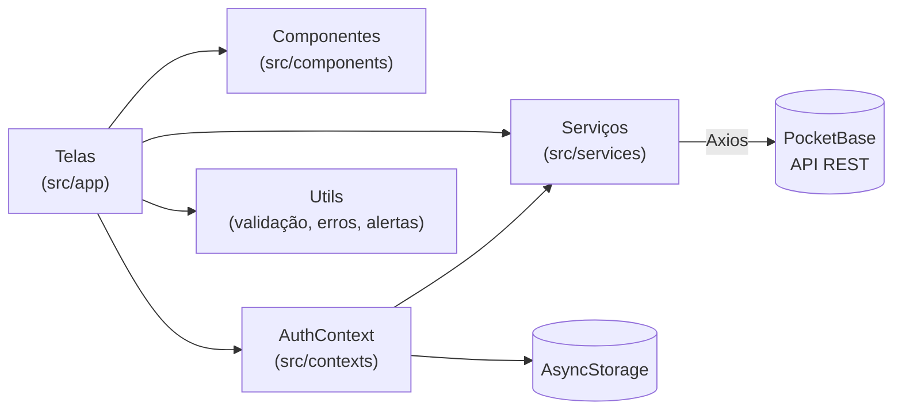
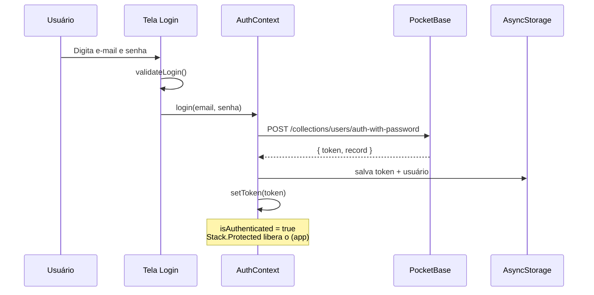

# Documentação Técnica — GameDex

Este documento explica **o que foi feito** no projeto e **como** cada requisito técnico foi atendido. Também aponta os arquivos onde cada parte está implementada.

## Sumário

1. [Visão geral da arquitetura](#1-visão-geral-da-arquitetura)
2. [Navegação com Expo Router](#2-navegação-com-expo-router)
3. [Autenticação com Context API](#3-autenticação-com-context-api)
4. [Persistência de sessão (AsyncStorage)](#4-persistência-de-sessão-asyncstorage)
5. [Consumo da API com Axios](#5-consumo-da-api-com-axios)
6. [Leitura de dados (GET)](#6-leitura-de-dados-get)
7. [Criação e exclusão (POST / DELETE)](#7-criação-e-exclusão-post--delete)
8. [Edição de registros (PATCH)](#8-edição-de-registros-patch)
9. [Lista otimizada com FlatList](#9-lista-otimizada-com-flatlist)
10. [Estados de carregamento e erro](#10-estados-de-carregamento-e-erro)
11. [Estilização e layout](#11-estilização-e-layout)
12. [Testes unitários com Jest](#12-testes-unitários-com-jest)
13. [Validação de formulários](#13-validação-de-formulários)
14. [Dependências adicionadas](#14-dependências-adicionadas)
15. [Checklist de requisitos](#15-checklist-de-requisitos)

---

## 1. Visão geral da arquitetura

O código está organizado em **camadas**, e cada pasta tem uma responsabilidade:



| Pasta | Responsabilidade |
| --- | --- |
| `src/app/` | Somente rotas e telas. O Expo Router transforma cada arquivo daqui em uma tela. |
| `src/contexts/` | Estado global de autenticação |
| `src/services/` | Comunicação com a API: uma instância do Axios e uma função por endpoint |
| `src/components/` | Componentes visuais reutilizáveis |
| `src/styles/` | Estilos das telas. Ficam fora de `app/` para não serem tratados como rotas. |
| `src/utils/` | Funções puras: validação, tradução de erros, alertas e formatação |
| `src/theme/` | Cores, espaçamentos, bordas e tamanhos de fonte |
| `src/types/` | Tipos TypeScript compartilhados (`User`, `Game`, `GameInput`…) |
| `src/__tests__/` | Testes unitários |

O alias `@/` aponta para `src/`, definido no [tsconfig.json](tsconfig.json). Com isso, os imports ficam no formato `@/components/Button` em vez de caminhos relativos longos.

---

## 2. Navegação com Expo Router

Toda a navegação usa o **Expo Router**, que funciona por arquivos: cada arquivo em `src/app/` vira uma rota. As telas são separadas em dois **grupos** (pastas entre parênteses, que não aparecem na URL):

```
src/app/
├── _layout.tsx          → layout raiz: escolhe qual fluxo fica liberado
├── (auth)/              → FLUXO PÚBLICO
│   ├── _layout.tsx
│   └── login.tsx        → /login
└── (app)/               → FLUXO RESTRITO
    ├── _layout.tsx      → Stack com cabeçalho e botão "Sair"
    ├── index.tsx        → /            (lista de jogos)
    └── jogos/
        ├── novo.tsx     → /jogos/novo  (cadastro)
        └── [id].tsx     → /jogos/:id   (edição; rota dinâmica)
```

### Proteção das rotas

Em [src/app/_layout.tsx](src/app/_layout.tsx), o componente `Stack.Protected` libera ou bloqueia cada grupo conforme o estado de autenticação:

```tsx
<Stack screenOptions={{ headerShown: false, contentStyle: styles.content }}>
  <Stack.Protected guard={isAuthenticated} redirectTo="/login">
    <Stack.Screen name="(app)" />
  </Stack.Protected>
  <Stack.Protected guard={!isAuthenticated} redirectTo="/">
    <Stack.Screen name="(auth)" />
  </Stack.Protected>
</Stack>
```

- Quando o `guard` é `false`, a rota fica inacessível e o usuário é levado para o endereço definido em `redirectTo`: `/login` se não estiver logado, `/` (lista de jogos) se já estiver.
- O `redirectTo` é necessário. Sem ele, o Expo Router redirecionaria para o próprio grupo, `/(auth)`. Como esse grupo não tem um `index`, o resultado seria a tela "Unmatched Route".
- Por isso o redirecionamento após login e logout é **automático**. Basta o token mudar no contexto: nenhuma tela precisa chamar `router.replace("/login")` manualmente.
- Enquanto a sessão salva está sendo restaurada (`isLoading`), o layout mostra uma tela de carregamento. Isso evita que a tela de login "pisque" antes de o app abrir a área logada.

Entre as telas restritas, a navegação usa `router.push(...)` e `router.back()`. A tela de edição lê o id da URL com `useLocalSearchParams`.

---

## 3. Autenticação com Context API

Arquivo: [src/contexts/AuthContext.tsx](src/contexts/AuthContext.tsx)

O contexto segue o padrão pedido:

1. **Interface das props** (`AuthContextProps`)
2. **Contexto criado como `undefined`**: `createContext<AuthContextProps | undefined>(undefined)`
3. **Provider próprio** (`AuthContextProvider`, exportado como `default`), que guarda todo o estado
4. **Hook consumidor** (`useAuthContext`), que lança um erro se for usado fora do provider

```ts
export interface AuthContextProps {
  user: User | null;        // usuário logado
  token: string | null;     // token JWT retornado pelo PocketBase
  isAuthenticated: boolean; // !!token
  isLoading: boolean;       // true enquanto restaura a sessão salva
  login: (email: string, password: string) => Promise<void>;
  logout: () => Promise<void>;
}
```

### Fluxo de login



### Logout

A função `logout()` remove o token do Axios, limpa o estado e apaga os dados do AsyncStorage. Com o token nulo, o `Stack.Protected` volta para o login. O botão **Sair** fica no cabeçalho da lista e pede confirmação antes de sair.

### Sessão expirada

O provider registra um **interceptor do Axios**. Se qualquer requisição autenticada receber `401`, o logout é feito automaticamente.

---

## 4. Persistência de sessão (AsyncStorage)

Duas chaves são usadas:

| Chave | Conteúdo |
| --- | --- |
| `@catalogo-jogos:token` | Token de autenticação |
| `@catalogo-jogos:user` | Dados do usuário (JSON) |

**Ao fazer login:** o token e o usuário são gravados com `AsyncStorage.multiSet`.

**Ao abrir o app**, um `useEffect` do provider executa estes passos:

1. Lê as duas chaves com `AsyncStorage.multiGet`.
2. Se existir um token, coloca-o no header do Axios e chama `POST /collections/users/auth-refresh` para **validá-lo no servidor**. Essa chamada também devolve um token renovado.
3. O resultado define o que acontece:
   - **Token válido:** salva o token renovado e entra direto na área restrita, sem pedir credenciais.
   - **Token inválido ou expirado** (401/403): faz logout e mostra o login.
   - **Sem internet:** mantém a sessão salva localmente. As telas avisam do erro de rede quando tentarem buscar dados.
4. Por fim, `isLoading = false` libera a navegação.

---

## 5. Consumo da API com Axios

Arquivo: [src/services/api.ts](src/services/api.ts)

Uma instância única do Axios é configurada com:

- `baseURL`: `${EXPO_PUBLIC_API_URL}/api`. O endereço vem do `.env`, e o padrão é `http://127.0.0.1:8090`.
- `timeout` de 10 segundos.
- A função `setAuthToken(token)`, que coloca ou remove o header `Authorization` em todas as requisições seguintes.

As chamadas ficam agrupadas por assunto:

| Arquivo | Função | Método | Endpoint |
| --- | --- | --- | --- |
| [auth.ts](src/services/auth.ts) | `loginRequest` | POST | `/collections/users/auth-with-password` |
| [auth.ts](src/services/auth.ts) | `refreshRequest` | POST | `/collections/users/auth-refresh` |
| [games.ts](src/services/games.ts) | `listGames` | **GET** | `/collections/jogos/records?sort=-created` |
| [games.ts](src/services/games.ts) | `getGame` | **GET** | `/collections/jogos/records/:id` |
| [games.ts](src/services/games.ts) | `createGame` | **POST** | `/collections/jogos/records` |
| [games.ts](src/services/games.ts) | `updateGame` | **PATCH** | `/collections/jogos/records/:id` |
| [games.ts](src/services/games.ts) | `deleteGame` | **DELETE** | `/collections/jogos/records/:id` |

Separar as chamadas assim mantém as telas desacopladas da API. Se o backend mudar, apenas `services/` precisa ser alterado.

### Modelo de dados

```ts
interface Game {
  id: string;
  titulo: string;
  genero: string;
  plataforma: string;
  ano: number;
  nota: number;      // 0 a 10
  descricao?: string;
}
```

---

## 6. Leitura de dados (GET)

Tela: [src/app/(app)/index.tsx](src/app/(app)/index.tsx)

- A lista é carregada com `listGames()` dentro de `useFocusEffect`. Assim, os dados são **buscados de novo sempre que a tela volta ao foco**, por exemplo depois de cadastrar ou editar um jogo.
- A primeira carga mostra um carregamento em tela cheia. As recargas seguintes mostram um indicador menor no topo da lista, sem esconder os dados.
- Também existe **"puxar para atualizar"** (`RefreshControl`).

A tela de edição usa `getGame(id)` para buscar o registro específico antes de preencher o formulário.

---

## 7. Criação e exclusão (POST / DELETE)

### Cadastro: [src/app/(app)/jogos/novo.tsx](src/app/(app)/jogos/novo.tsx)

1. Usa o componente reutilizável [GameForm](src/components/GameForm/index.tsx) com os campos título, gênero, plataforma, ano, nota e descrição.
2. Ao enviar, o formulário é **validado** (veja a [seção 13](#13-validação-de-formulários)). Se houver erros, eles aparecem embaixo de cada campo e nada é enviado.
3. Se estiver tudo certo, os valores são convertidos para o formato da API: textos sem espaços nas pontas e números convertidos (`"8,5"` vira `8.5`).
4. A função `createGame()` envia o **POST**. Em caso de sucesso, aparece um alerta e o app volta para a lista, que se atualiza sozinha.

### Exclusão: botão "Excluir" em cada card

1. Um diálogo de confirmação aparece (`showConfirm`).
2. Ao confirmar, `deleteGame(id)` envia o **DELETE**. Enquanto a requisição está em andamento, o botão daquele card mostra um `ActivityIndicator`.
3. Em caso de sucesso, o item sai da lista na hora, sem precisar recarregar tudo.

---

## 8. Edição de registros (PATCH)

Tela: [src/app/(app)/jogos/[id].tsx](src/app/(app)/jogos/[id].tsx)

1. O `id` vem da URL (`useLocalSearchParams`).
2. O jogo é buscado com **GET**. Enquanto isso, aparece uma tela de carregamento. Se der erro, aparece uma mensagem com o botão "Tentar novamente".
3. O mesmo `GameForm` do cadastro é reaproveitado, já preenchido. A função `gameToFormValues` converte os números em texto para os campos.
4. Ao salvar, `updateGame(id, dados)` envia um **PATCH**, que atualiza só os campos enviados. Depois o app volta para a lista.

---

## 9. Lista otimizada com FlatList

A lista de jogos usa `<FlatList>`, que renderiza só os itens visíveis na tela:

```tsx
<FlatList
  data={games}
  keyExtractor={(item) => item.id}          // id único vindo do PocketBase
  renderItem={({ item }) => <GameCard ... />}
  ItemSeparatorComponent={...}
  ListHeaderComponent={...}                 // saudação + contador de jogos
  ListEmptyComponent={...}                  // feedback quando não há registros
  refreshControl={<RefreshControl ... />}   // puxar para atualizar
/>
```

- **`keyExtractor`** usa o `id` do registro, que é único no banco.
- **`ListEmptyComponent`** mostra duas mensagens diferentes:
  - Se o servidor devolveu um array vazio: 🎮 *"Nenhum jogo por aqui"*, com um botão para adicionar o primeiro jogo.
  - Se houve erro de rede: 📡 *"Não foi possível carregar"*, com um botão "Tentar novamente".
- O `GameCard` é envolvido em `React.memo`, e as funções `onEdit`/`onDelete` usam `useCallback`. Assim, os cards não são renderizados de novo sem necessidade.

---

## 10. Estados de carregamento e erro

**Toda** requisição tem um indicador de carregamento e um tratamento de erro:

| Ação | Carregamento (`ActivityIndicator`) | Erro |
| --- | --- | --- |
| Restaurar sessão | Tela cheia: "Restaurando sessão..." | Logout ou sessão local mantida |
| Login | Spinner dentro do botão "Entrar" | Alerta "E-mail ou senha inválidos" ou erro de rede |
| Listar jogos | Tela cheia e depois spinner no topo da lista | Alerta + mensagem na lista com "Tentar novamente" |
| Buscar jogo (edição) | Tela cheia: "Carregando jogo..." | Alerta + mensagem com "Tentar novamente" |
| Cadastrar / Salvar | Spinner no botão, campos desabilitados | Alerta "Erro ao salvar" |
| Excluir | Spinner no botão "Excluir" do card | Alerta "Erro ao excluir" |

### Mensagens amigáveis: [src/utils/errors.ts](src/utils/errors.ts)

A função `getErrorMessage(error)` converte qualquer erro em uma mensagem em português:

| Situação | Mensagem |
| --- | --- |
| Sem resposta do servidor | "Não foi possível conectar ao servidor…" |
| Timeout | "O servidor demorou demais para responder…" |
| 401 | "Sua sessão expirou. Faça login novamente." |
| 403 | "Você não tem permissão para realizar esta ação." |
| 404 | "Registro não encontrado." |
| 5xx | "Erro interno no servidor…" |
| Outros | A mensagem retornada pelo PocketBase |

### Alertas no celular e na web: [src/utils/alert.ts](src/utils/alert.ts)

`Alert.alert` não funciona no Expo Web. Por isso foram criadas duas funções que verificam a plataforma:

```ts
export function showAlert(title: string, message?: string) {
  if (Platform.OS === "web") window.alert(...);
  else Alert.alert(title, message);
}
```

`showConfirm` faz o mesmo para confirmações: usa `window.confirm` na web e um `Alert.alert` com botões "Cancelar"/"Confirmar" no celular.

---

## 11. Estilização e layout

### Identidade visual

O app usa um tema escuro com roxo como cor principal. Todos os valores ficam centralizados em [src/theme/index.ts](src/theme/index.ts):

| Token | Cor | Uso |
| --- | --- | --- |
| `background` | `#0F0E17` | Fundo das telas |
| `surface` | `#1C1B29` | Cards e cabeçalho |
| `primary` | `#7F5AF0` | Botões e destaques |
| `accent` | `#2CB67D` | Nota alta (≥ 8) |
| `warning` | `#F9A826` | Nota média (5 a 7,9) |
| `danger` | `#E53170` | Nota baixa, excluir e erros |

Espaçamentos (`spacing`), raios de borda (`radius`) e tamanhos de fonte (`fontSize`) também vêm do tema. Com isso, nenhum valor de estilo fica espalhado pelo código.

### Boas práticas aplicadas

- **`StyleSheet.create`** em todos os arquivos de estilo.
- **Estilos fisicamente separados:**
  - Cada componente tem sua pasta com `index.tsx` (lógica) e `styles.ts` (estilos):
    ```
    components/Button/
    ├── index.tsx
    └── styles.ts
    ```
  - Os estilos das telas ficam em `src/styles/*.styles.ts`.
- **Nenhum estilo inline nas tags.** As tags recebem só referências como `style={styles.card}`. Estilos condicionais são combinados em arrays, por exemplo `style={[styles.base, styles[variant], pressed && styles.pressed]}`.
- **Flexbox** em todos os layouts:
  - `flex: 1` nos contêineres de tela
  - `flexDirection: "row"` com `gap` nas linhas: campos Ano e Nota lado a lado, tags e botões do card
  - `justifyContent` / `alignItems` para centralizar o login e os estados vazios
  - `flexWrap: "wrap"` nas tags de gênero e plataforma

### Componentes reutilizáveis

| Componente | Descrição |
| --- | --- |
| [Button](src/components/Button/index.tsx) | Botão com variantes `primary`, `secondary` e `danger`. Tem estado `loading` (mostra spinner e bloqueia o clique) e acessibilidade. |
| [TextField](src/components/TextField/index.tsx) | Campo de texto com rótulo e mensagem de erro. A borda fica vermelha quando há erro. |
| [GameCard](src/components/GameCard/index.tsx) | Card do jogo com selo de nota colorido, tags e botões Editar/Excluir |
| [GameForm](src/components/GameForm/index.tsx) | Formulário completo com validação, usado no cadastro e na edição |
| [StatusView](src/components/StatusView/index.tsx) | `LoadingView` (carregamento em tela cheia) e `EmptyState` (lista vazia ou erro, com ação) |

---

## 12. Testes unitários com Jest

O Jest está configurado com o preset **`jest-expo`** no `package.json`. Os componentes são testados com a **React Native Testing Library**. Para rodar:

```bash
yarn test
```

São **26 testes** em 3 arquivos:

### [validation-test.ts](src/__tests__/validation-test.ts): funções de validação

- `isValidEmail` aceita e-mails válidos e rejeita os inválidos.
- `parseNumber` converte `"8,5"` em `8.5` e devolve `NaN` para textos inválidos.
- `validateLogin` exige e-mail e senha e confere o tamanho mínimo da senha.
- `validateGameForm` exige os campos obrigatórios e confere os limites de ano e nota.
- `formToGameInput` converte os valores do formulário para o formato da API.

### [format-errors-test.ts](src/__tests__/format-errors-test.ts): funções de formatação e de erro

- `getRatingLevel` classifica a nota como alta, média ou baixa.
- `formatRating` formata no padrão brasileiro (`8.5` vira `"8,5"`).
- `getErrorMessage` trata falha de conexão, timeout, status 401/404/500, mensagem vinda da API e erros genéricos.

### [components-test.tsx](src/__tests__/components-test.tsx): componentes

- **Button:** renderiza o título e dispara `onPress`. Com `loading`, mostra o spinner e **bloqueia** o clique.
- **TextField:** mostra o rótulo e o erro e repassa o texto digitado.
- **GameCard:** exibe os dados do jogo e dispara editar e excluir. Mostra o spinner durante a exclusão.
- **EmptyState:** mostra a mensagem e dispara a ação.
- **GameForm:** não envia o formulário vazio e mostra os erros. Com dados válidos, envia o payload já convertido.

```
Test Suites: 3 passed, 3 total
Tests:       26 passed, 26 total
```

---

## 13. Validação de formulários

Arquivo: [src/utils/validation.ts](src/utils/validation.ts)

As validações rodam **no app, antes de qualquer requisição**. Isso evita chamadas desnecessárias à API e dá retorno imediato ao usuário.

| Campo | Regra |
| --- | --- |
| E-mail (login) | Obrigatório e com formato válido |
| Senha (login) | Obrigatória, com no mínimo 8 caracteres (mesmo mínimo do PocketBase) |
| Título | Obrigatório, com no máximo 100 caracteres |
| Gênero / Plataforma | Obrigatórios |
| Ano | Número inteiro entre 1950 e o ano atual + 2 |
| Nota | Número entre 0 e 10, aceitando vírgula (`8,5`) |
| Descrição | Opcional, com no máximo 500 caracteres |

O erro de cada campo some assim que o usuário começa a corrigi-lo.

---

## 14. Dependências adicionadas

Todas foram instaladas com `npx expo install`, que escolhe as versões compatíveis com o SDK 58.

| Pacote | Tipo | Motivo |
| --- | --- | --- |
| `axios` | produção | Requisições HTTP |
| `@react-native-async-storage/async-storage` | produção | Persistência da sessão |
| `jest`, `jest-expo`, `@types/jest` | desenvolvimento | Ambiente de testes |
| `@react-native/jest-preset` | desenvolvimento | Exigido pelo `jest-expo` 58 |
| `@testing-library/react-native` | desenvolvimento | Testes de componentes |
| `eslint`, `eslint-config-expo` | desenvolvimento | Lint (configurado pelo `npx expo lint`) |

Outras mudanças de configuração:

- **`tsconfig.json`:** alias `@/*` apontando para `./src/*` e tipos do Jest.
- **`package.json`:** scripts `test`, `lint` e `typecheck`, além da configuração do Jest (preset e mapeamento do alias `@/`).
- **`app.json`:** nome "GameDex", tema escuro e splash com fundo escuro.
- **`.env.example`:** modelo para configurar o endereço da API.

---

## 15. Checklist de requisitos

| # | Requisito | Status | Onde |
| --- | --- | --- | --- |
| 1 | Expo Router com fluxo público (login) e fluxo restrito | ✅ | `src/app/(auth)`, `src/app/(app)`, `Stack.Protected` |
| 2 | Context API com usuário, token, login e logout que trocam o fluxo | ✅ | `src/contexts/AuthContext.tsx` |
| 3 | Token persistido no AsyncStorage e sessão restaurada ao reabrir | ✅ | `AuthContext.tsx` (`restoreSession`) |
| 4 | Listagem via GET com Axios | ✅ | `services/games.ts` → `listGames` |
| 5 | Formulário com POST e exclusão com DELETE | ✅ | `jogos/novo.tsx`, `deleteGame` |
| 6 | Edição com PATCH | ✅ | `jogos/[id].tsx` → `updateGame` |
| 7 | FlatList com `keyExtractor` e `ListEmptyComponent` | ✅ | `(app)/index.tsx` |
| 8 | `ActivityIndicator` e alertas de erro (com suporte à web) | ✅ | Todas as telas, `utils/alert.ts`, `utils/errors.ts` |
| 9 | `StyleSheet.create`, Flexbox e estilos separados | ✅ | `components/*/styles.ts`, `src/styles/`, `src/theme/` |
| 10 | Testes unitários com Jest (mínimo de 3) | ✅ | `src/__tests__/` (26 testes) |
